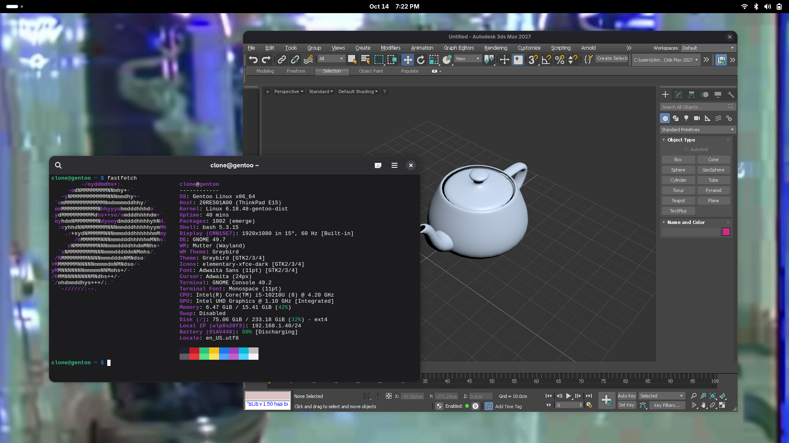

# 3ds Max 2027 on Linux (Wine)

Autodesk 3ds Max 2027 (29.2.0.20588) runs on Linux under a patched Wine 11.0. Sign-in uses a normal Autodesk account. The Nitrous viewport renders through DXVK.

Claude was used to get through the Autodesk installer from start to end: launch, find out exactly why it stops, fix the cause (in Wine when Wine is at fault), repeat.
Licensing goes through the regular Autodesk sign-in.

Nothing here touches or bypasses Autodesk licensing.



## Status

| # | Stage | State |
|---|-------|-------|
| 0 | Installer media verified (Authenticode, all Autodesk-signed) | ✅ |
| 1 | Prefix + runtimes (VC++ 2022, .NET 8/10, WebView2, DXVK) | ✅ |
| 2 | Autodesk Desktop Licensing service running | ✅ patch 0003 |
| 3 | `3dsMax.msi` installed, product 128S1 registered | ✅ |
| 4 | `3dsmax.exe` starts; product strings and UPI resolve | ✅ patch 0004 |
| 5 | Sign-in: Identity Manager → system browser → `adskidmgr://` handed back into Wine | ✅ |
| 6 | Main UI (Qt, WinForms, WPF) | ✅ |
| 7 | Nitrous viewport (D3D11 via DXVK), no white flashes | ✅ patch 0074 |
| 8 | Embedded WebView2 panels (license-type page, Identity Manager window) | ⚠️ blank or black; avoided, see Known issues |

Tested so far: creating and editing primitives, viewport navigation, UI panels. Startup takes about 30 s on an i5-10210U with UHD 620.

Skipped on purpose: the Material Library (MSIX/AdIX, ODIS error 4005), Arnold, USD, Substance, and other optional plugins.

The full investigation log, with symptom, root cause and fix for each step, is in [docs/JOURNAL.md](docs/JOURNAL.md).

## Wine patches (`patches/wine-11.0/`, 74 files, one linear series on `wine-11.0`)

| Patch | Module | Fixes |
|-------|--------|-------|
| 0001 | ntdll | `<exe>.config` `<probing privatePath>`. ODIS `Setup.exe` couldn't load its assemblies. |
| 0002 | wintrust | `WTD_CHOICE_BLOB` + AppX P7X SIP. ODIS couldn't verify MSIX signatures. |
| 0003 | ntdll | Report `services.exe` as session 0. Go/.NET services (`svc.IsWindowsService`) otherwise run as console apps and the service start times out (1053). |
| 0004 | kernelbase | MUI satellite fallback (`<dir>\<lang>\<name>.mui`). Without it every language-neutral DLL returns empty strings, and 3ds Max fails at startup. |
| 0005–0070 | dcomp | Backport of wine-staging's DirectComposition series by Zhiyi Zhang (CodeWeavers). WebView2's GPU process needs `DCompositionCreateDevice`. |
| 0071–0072 | include | `dcomp.idl` / `d2d1effects.idl` from upstream master, needed by the backport. |
| 0073 | dxgi | staging's `CreateSwapChainForComposition` hack, used only by `msedgewebview2.exe`. |
| 0074 | server | Clip GL/Vulkan client areas of `WS_EX_TRANSPARENT` child windows out of the parent surface. The Nitrous viewport is such a window; white-initialised surface pixels were flushed over every frame, causing white flashes. |

Modules built from these and layered onto the private Wine tree are listed in [`scripts/patched-modules.txt`](scripts/patched-modules.txt):
`ntdll.so`, `ntdll.dll`, `wintrust.dll`, `kernelbase.dll`, `dcomp.dll`, `dxgi.dll`, `wineserver`.

## Reproducing

This assumes Gentoo with `app-emulation/wine-vanilla-11.0` (USE `wow64 vulkan opengl X wayland mingw`), a Vulkan driver (Mesa ANV here), and:

- build tools: `dev-vcs/git`, `sys-devel/flex`, `sys-devel/bison`, `dev-util/mingw64-toolchain` (USE=mingw pulls the last three in to build wine-vanilla, but `emerge --depclean` removes them again)
- `app-emulation/winetricks`, `net-misc/curl`, `x11-misc/xdg-utils`, python 3
- the 3ds Max 2027 installer media unpacked to `~/3dsmax-setup` (or set `MAXSRC`)

The repo can be cloned anywhere; the scripts find it from their own location. The prefix is `~/.wine-3dsmax`, the private Wine tree goes to `~/opt/wine-11.0-patched`, and the Wine source to `~/src/wine-11.0` (or set `WINESRC`).

```sh
scripts/make-wine-tree.sh            # private copy of wine-vanilla-11.0 in ~/opt, system wine untouched
scripts/build-wine.sh                # apply patches/wine-11.0, build + deploy the patched modules
make -C tools                        # sigcheck.exe, winlist.exe, muitest.exe
scripts/setup-prefix.sh              # prefix, VC++, .NET 8/10, WebView2, DXVK
scripts/install-licensing.sh         # expect "STATE : 4 RUNNING"
scripts/install-max-msi.sh           # core 3dsMax.msi without ODIS
scripts/install-identity-manager.sh  # ODIS + Identity Manager 1.12.0.7 from Autodesk's CDN + adskidmgr:// handler
scripts/set-named-user.sh            # named-user licensing (skips the WebView2 license-type page)
scripts/setup-webview2.sh            # WebView2 flags + per-app d3d overrides
scripts/install-launcher.sh          # one "3ds Max 2027" launcher with icon and .max file type, removes the installer's shortcuts
```

Then start **3ds Max 2027** from the app grid, or run `scripts/run-3dsmax.sh [file.max]`. On first launch Identity Manager opens the Autodesk sign-in page in your browser. After you log in, the browser offers to open an `adskidmgr://` link; allow it. Logs are written to `logs/`.

## Layout

```
docs/JOURNAL.md                 hill-climb log
patches/wine-11.0/              wine patch series (git format-patch)
patches/staging-dcomp/          the original wine-staging dcomp series, for reference
scripts/                        setup, build, deploy, launch (see above)
tools/sigcheck.c                WinVerifyTrust signature checker
tools/winlist.c                 window tree with X11 ids, plus click/show/hide/redraw/class (debugging aid)
tools/muitest.c                 LoadString test for MUI fallback
logs/ snapshots/ downloads/ extract/   local only (gitignored)
```

## Known issues

- **Embedded WebView2 renders blank or black.** The browser processes draw into child windows whose top-level belongs to another process (the Autodesk host app). Wine 11 can't composite cross-process child windows: GDI and offscreen GL/Vulkan blits get overwritten by the owner's surface. Login avoids WebView2 entirely by using the system browser. Proper fix: cross-process client surfaces in win32u/winex11 (not done).
- **GNOME "is not responding" dialogs.** Mutter pings windows. If 3ds Max's main thread is busy, as in long loads, nobody answers. Raising the timeout helps: `gsettings set org.gnome.mutter check-alive-timeout 30000`.
- **First launch "Privacy Settings" dialog kills 3ds Max** (exit 244) when submitted, and the answer is never saved, so it keeps coming back. Run `scripts/set-privacy-consent.sh` after signing in once; it records the preferences (default: optional data collection off).
- **GNOME title bar too tall?** `scripts/desktop/install-slim-titlebars.sh` slims title bars of X11 windows (all of them, not just 3ds Max) via `~/.config/gtk-4.0/gtk.css`. Wine's own caption (`Decorated=N`) was tried and looks like Windows 95.
- **Never launch through the system `wine`.** The installer's own shortcuts use the unpatched system Wine. `install-launcher.sh` removes them, and `env.sh` disables winemenubuilder so they don't come back.
- `RegisterInventorServerHost` (Inventor import) wasn't registered by the MSI under Wine. To fix it by hand, run `MaxInventorServerHost.exe /regserver`.
- Edge Selection is not visible (Editable Poly)

## Installer workarounds

- **The build dir must use Gentoo's install paths.** `ntdll.so` bakes in `DATADIR`; with `/usr/local` it can't load `l_intl.nls` and segfaults in `ntdll_towupper`.
- **`Current?` directories are normal.** Wine 11 stores junctions as `name?` plus the `user.WINEREPARSE` xattr.
- **msiexec quoting.** Wine turns `"PROP=C:\a b"` into `"PROP="C:\a b""` (exit 1639), so the MSI is run from a `.bat`.
- **DLL overrides.** `*name` keys beat plain `name` keys, so per-app overrides must also use the `*` form.
